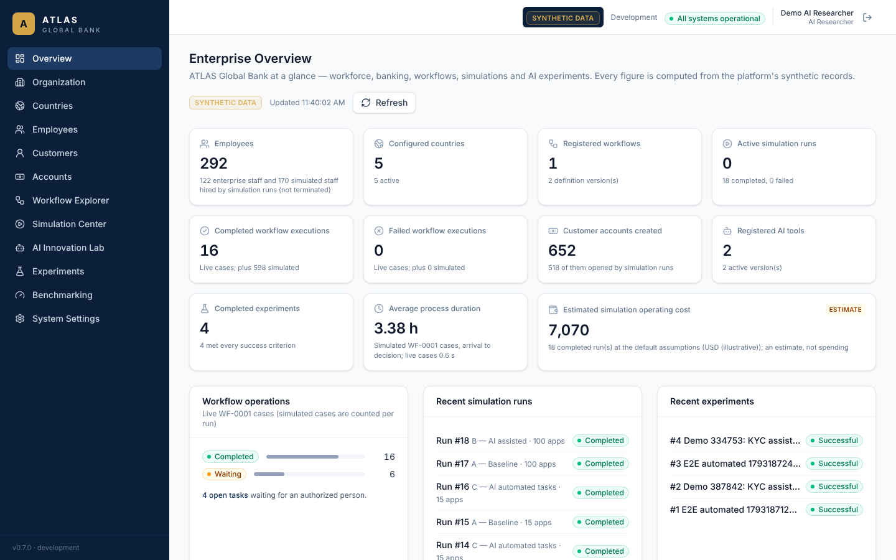
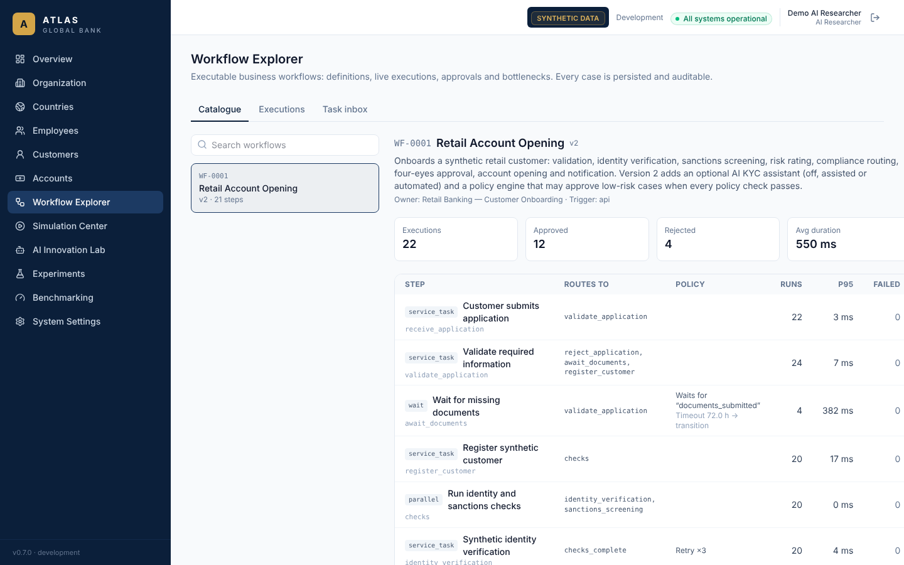
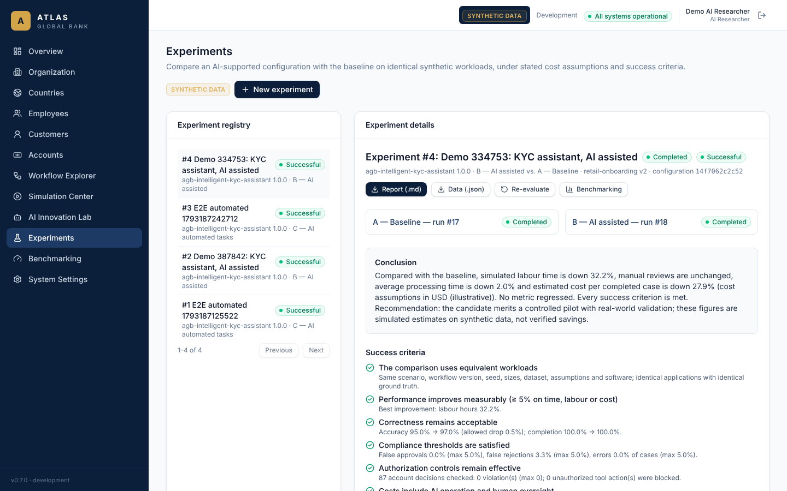
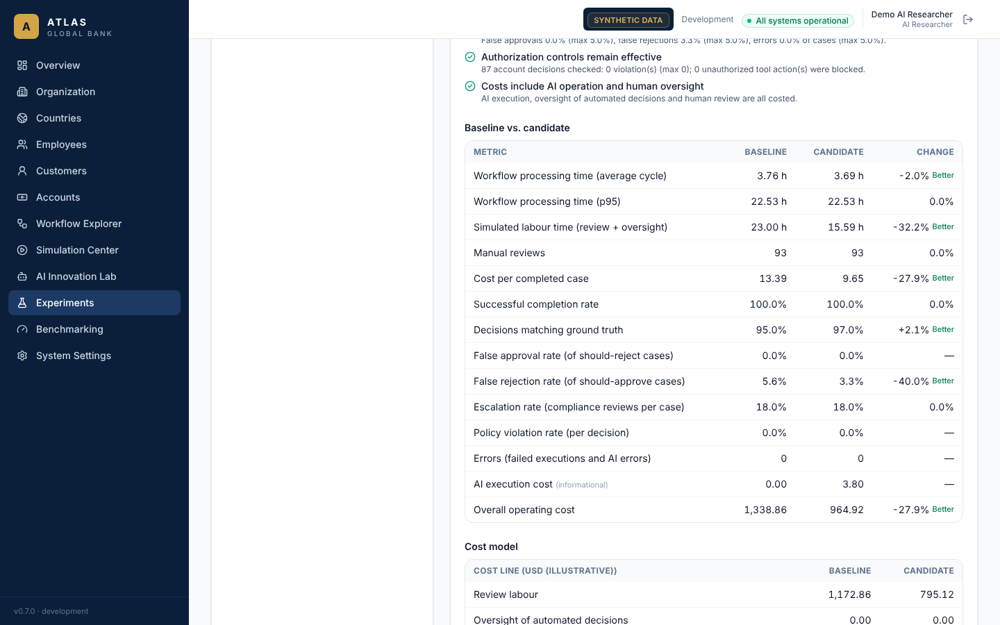
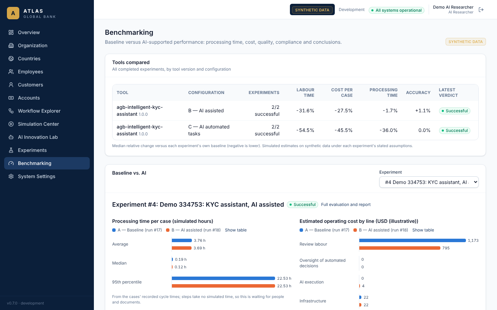
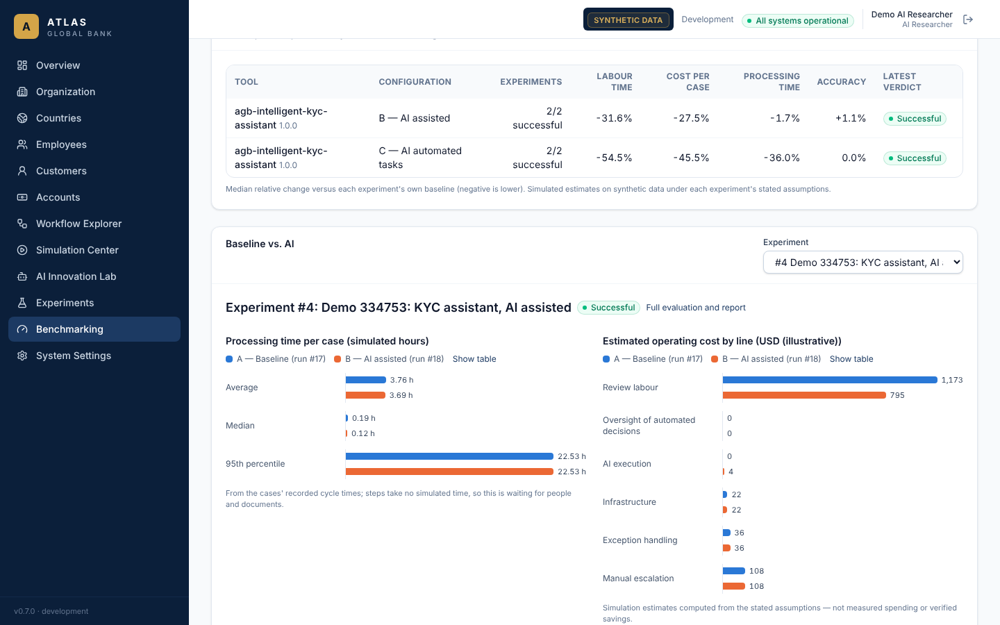
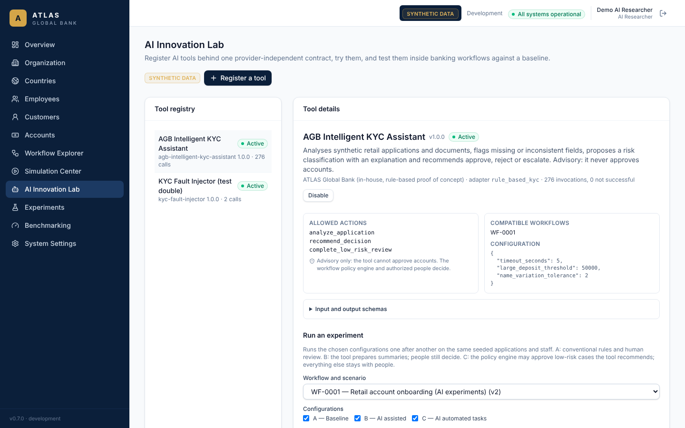

# Demonstration: AI-assisted bank account opening

The first complete end-to-end journey through ATLAS Global Bank (specification Part 12).
It runs through the frontend, backend, workflow engine, database, simulation system and AI
evaluation layer. It is automated as the Playwright test
`DEMO (Part 12): AI-assisted bank account opening, end to end`
(`frontend/tests/e2e/simulations.spec.ts`), which passes against local processes and the
Docker Compose stack. The figures below come from one recorded run of that test
(seed 334753); every number is a simulation on synthetic data.

## Before you start

`make migrate && make seed` (or `docker compose up` then
`docker compose exec backend python -m app.cli seed-demo`), then open
<http://localhost:5173>. Password for all demo users: `atlas-demo-password`.

## Step 1 — Enter the platform

Sign in as **`researcher`** (AI Researcher). The role can register and test AI tools and
run simulations and experiments; it cannot approve accounts, see compensation or manage
users — the backend enforces this on every request.

## Step 2 — Explore the enterprise

The **Enterprise Overview** shows the organization's live figures, each computed from the
records by `GET /api/v1/analytics/overview` and linked to its screen: employees,
countries, workflows, active simulations, completed and failed executions, accounts, AI
tools, experiments, average process duration and the estimated simulation operating cost
(marked *Estimate*). **Organization** and **Employees** show the hierarchy and workforce.

## Step 3 — Select a workflow

**Workflow Explorer → WF-0001 Retail Account Opening** shows every step, route and policy,
including the advisory *AI KYC assistant review* and the *policy engine* steps of
version 2, with per-step metrics and the bottleneck.

## Steps 4–7 — Generate a workload, run the baseline and the AI-assisted mode

**Experiments → New experiment**: tool *AGB Intelligent KYC Assistant 1.0.0*, candidate
*B — AI assisted*, 100 applications, 25 simulated staff, a seed. The cost assumptions and
success thresholds are shown and editable before anything runs.

The platform generates 100 synthetic applications from the seed and runs them twice, one
run after the other: **A — Baseline** (conventional rules, simulated human review) and
**B — AI assisted** (the assistant prepares a recommendation and explanation for every
case; authorized people still make every decision). Both runs process the same
applications with the same staff; the experiment checks this rather than assuming it.

## Step 8 — Compare results

| | Baseline | AI assisted | Change |
| --- | ---: | ---: | ---: |
| Average processing time | 3.76 h | 3.69 h | −2.0 % |
| Simulated labour time (review + oversight) | 23.0 h | 15.6 h | −32.2 % |
| Manual reviews | 93 | 93 | unchanged — human approval preserved |
| Cost per completed case | 13.39 | 9.65 | −27.9 % |
| Decisions matching ground truth | 95.0 % | 97.0 % | +2 points |
| False rejection rate | 5.6 % | 3.3 % | −40 % |
| False approval rate | 0 % | 0 % | — |
| Policy violations | 0 | 0 | — |
| AI execution cost | 0.00 | 3.80 | (informational) |
| Overall operating cost | 1,338.86 | 964.92 | −27.9 % |

Costs in illustrative USD from the stated assumptions. The labour reduction rests on the
scenario's stated assumption that reviewers with an AI recommendation need 60 % of their
usual time — an assumption, not a measurement. Verdict: **successful** — all six criteria
met (equivalent workloads; ≥ 5 % improvement; correctness; compliance thresholds;
authorization controls; costs include AI and oversight).

**Benchmarking** charts the same experiment (processing time and cost lines, baseline vs.
AI, with table views), quality and compliance indicators, and compares tools across
experiments.

## Step 9 — Review failures

- **Misclassifications:** open the candidate run in the Simulation Center and tick *Only
  cases whose outcome differs from the ground truth* — each case shows its type, expected
  and actual outcome, the AI advice, reviews and cycle time.
- **Escalations:** compliance reviews per case (18 % in both runs) and the assistant's own
  escalations are shown in the run's *AI tool behaviour*.
- **Workflow exceptions:** document timeouts, overdue tasks, failed executions and AI
  errors are counted in the raw measurements and costed.
- **Policy violations:** every account decision of the run (87 here) is re-checked
  against four-eyes, approval authority, the policy engine's low-risk limit and the
  high-risk compliance rule — 0 violations; unauthorized tool actions blocked are listed
  too.

## Step 10 — Generate a report

**Report (.md)** downloads the proof-of-concept report: tested tool, scenario, workload,
data seed, software and tool versions, baseline and AI performance, operational
differences, financial assumptions and cost lines, security and compliance results,
success criteria, known limitations and the recommendation. **Data (.json)** exports the
full record; **Re-evaluate** recomputes the evaluation from the stored raw measurements
and confirms the same digest.

## What the demonstration shows — and does not

It shows a working, reproducible proof-of-concept pipeline: a candidate AI tool plugged
into a real (simulated) banking workflow behind permission and policy controls, measured
against a baseline on identical synthetic workloads, with transparent assumptions. It
does **not** show that the tool or any AI would save money in a real bank: the data is
synthetic, the reviewer behaviour is modelled, and the costs are assumptions.

