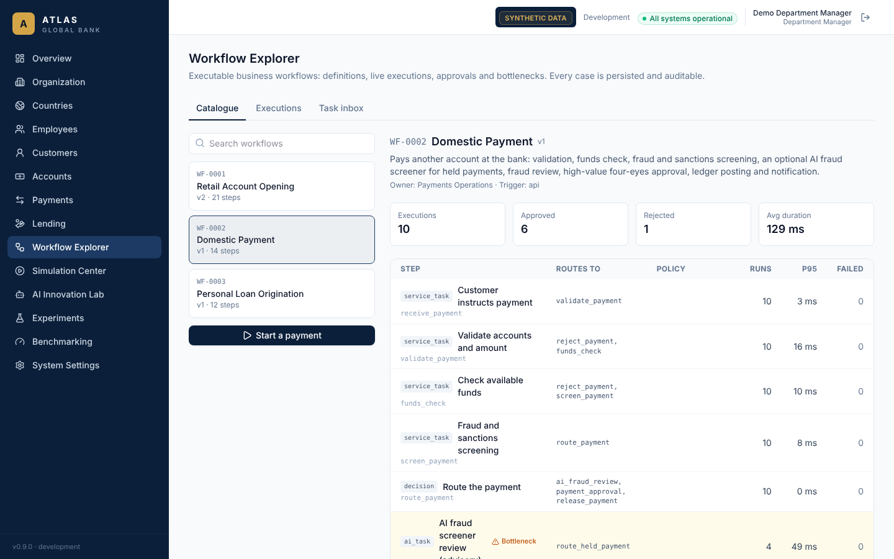
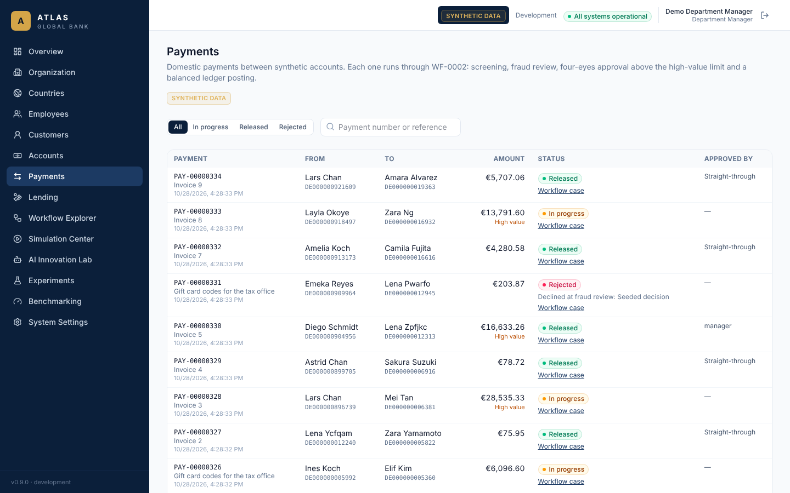
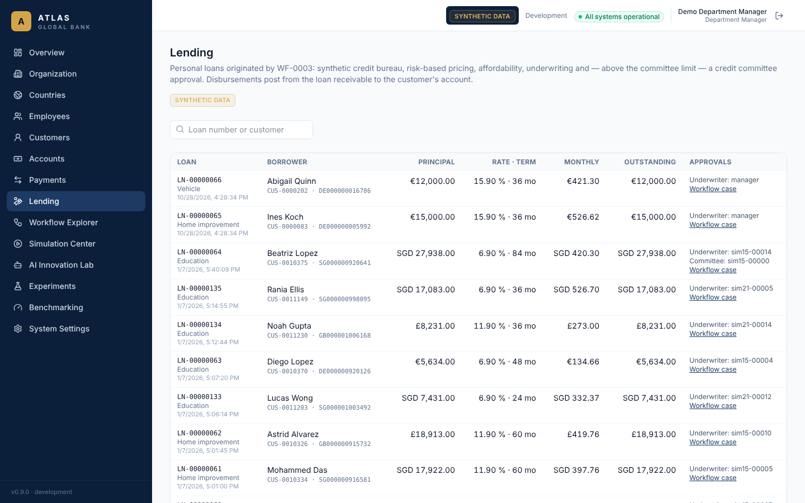
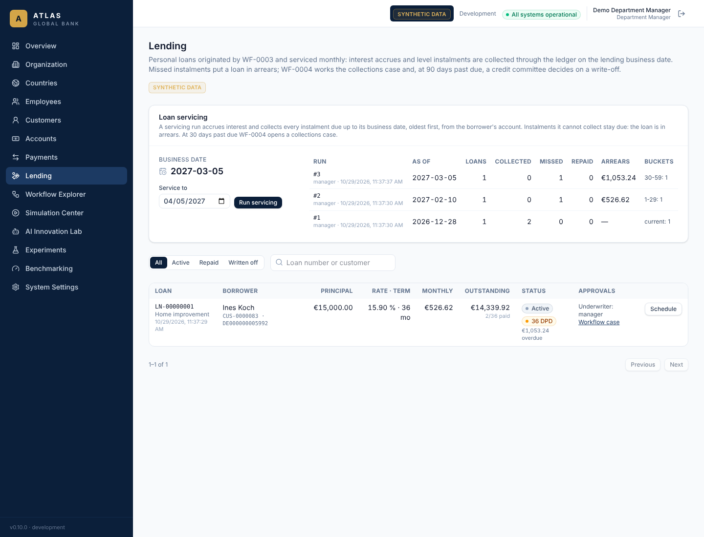
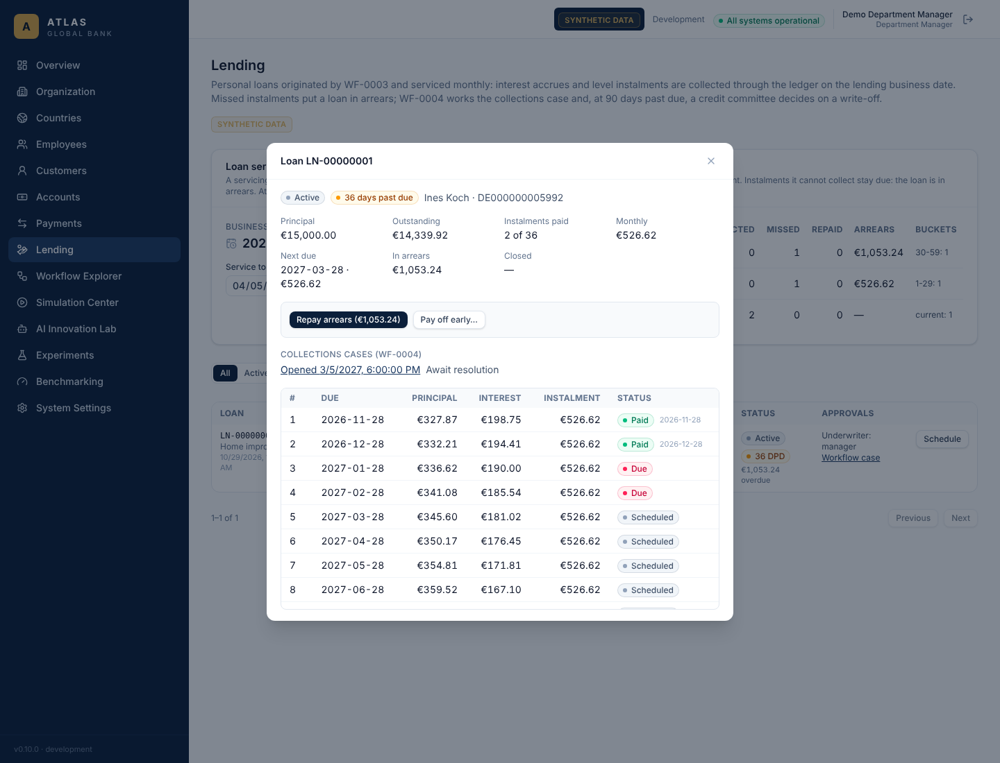
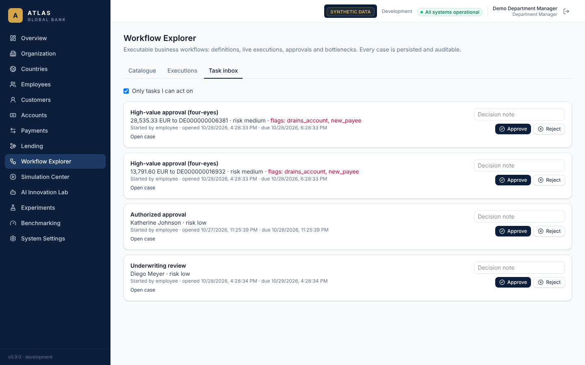

# Workflows

The workflow engine (Phase 4) is a durable, database-backed interpreter for versioned
business-process definitions. It is shared by every module: business logic lives in named
step handlers; the engine owns state, routing, approvals, retries, timeouts and history.

Code: `backend/app/modules/workflows/` — `definition.py` (model and validation),
`registry.py` (definitions and handlers), `engine.py` (execution), `wf0001.py` (the first
workflow), `service.py` / `router.py` (API).

## Definitions

A definition has `workflow_id` (`WF-0000` format), `name`, `version`, `description`,
`business_owner`, `trigger_type`, `input_schema` (generated from a Pydantic model),
`start` and `steps`. Its `transition_rules`, `approval_policies`, `failure_policies` and
`timeout_policies` are derived views returned by `GET /api/v1/workflows/{id}`.

Definitions are validated when registered: every referenced step exists, every
non-terminal step has a way forward, handlers are registered, parallel steps name a join,
approvals have transitions, at least one completion step exists and every step is
reachable. A version is immutable: re-registering it with different content fails, and the
first execution stores a snapshot (`workflow_definitions`) with a content hash that later
starts must match.

### Step types

| Type | Behaviour |
| --- | --- |
| `service_task` | Runs a registered handler. Retried on transient errors (`retry.max_attempts`, exponential `backoff_seconds`); then `on_failure` or the execution fails. |
| `human_task` | Waits for a person holding the step's permissions to submit its `form`. |
| `approval` | Waits for an `approve`/`reject` decision by a person holding every listed permission and not in `distinct_from` (`initiator` or earlier step ids — four-eyes). |
| `decision` | Routes on the first matching transition condition. |
| `parallel` / `join` | Starts every branch; the join runs once, after all branches arrive. |
| `wait` | Waits for a named signal and/or a timer. |
| `ai_task` | Calls a registered AI adapter (Phase 6 connects the AI tool registry). |
| `completion` / `failure` | Ends the execution (outcome from the step or `context.outcome`). |

Conditions are structured, never `eval`: `{"path": "a.b", "op": "eq", "value": …}` with
`eq, ne, in, not_in, gt, gte, lt, lte, exists, truthy`, combined with `all` / `any` and
`negate`. Timeouts either `flag` a task as overdue (audited) or `transition` elsewhere.

## Execution guarantees

- **Persisted state.** Executions, step runs (one row per visit; retries reuse it with
  `attempt` + 1) and an append-only event history (`workflow_events`, protected by a
  trigger, ordered by a database sequence) are all in PostgreSQL. Since Phase 15 the
  three tables are partitioned into live and simulation history (`realm`); live history
  can never be deleted, simulation history only by the archive and reset commands
  ([simulation.md](simulation.md#workflow-history-archive-restore-reset-phase-15)).
- **Atomic steps.** A handler runs inside a savepoint with its state transition. If it
  raises, its writes are rolled back and only the failure is recorded; if the process
  dies, the whole transaction rolls back and the step is still `pending`.
- **No duplicate execution.** Advancing locks the execution row; concurrent workers wait
  (or skip, in the runner) instead of running the same step. Tested with four threads.
- **Resumption.** `run_due` (the `workflow-timers` schedule of the job worker every minute
  since Phase 14, or `python -m app.cli run-workflows [--watch]`) advances
  every execution with due steps or expired timers, one execution per transaction, with
  `SKIP LOCKED`. A test commits one step, discards the session and resumes in a new one.
- **Validated transitions and approvals.** Only the engine moves state; approvals check
  permissions and four-eyes on every completion; a task can be completed once.
- **Timing.** Every run records `started_at`, `completed_at`, `duration_ms`; real time is
  read before each step (an explicit `now`, e.g. the simulation clock, freezes time).
- **Auditing.** `workflow.started`, `workflow.task_completed`, `workflow.task_overdue`,
  `workflow.completed` / `failed` / `cancelled` go to the audit log with correlation IDs.

## WF-0001 Retail Account Opening

| # | Step | Type | Notes |
| --- | --- | --- | --- |
| 1 | Customer submits application | service_task | Records receipt |
| 2 | Validate required information | service_task | Active country, age ≥ the country's minimum (18 by default; Phase 25) → else reject; missing accepted identity document or (where required) proof of address → wait |
| — | Wait for missing documents | wait | Signal `documents_submitted`; 72 h timeout → reject |
| 3 | Register synthetic customer | service_task | Creates the customer; KYC → pending |
| 4 | Identity verification ‖ sanctions screening | parallel | Synthetic document check digits, name/DOB match, expiry; synthetic watchlist |
| 5 | Assign customer risk rating | service_task | Score from sanctions hit, identity issues, PEP, large deposits, age |
| 6 | Evaluate compliance rules | service_task | Flags; `requires_review` when high risk or flagged |
| 7 | Route the case | decision | Forged documents → reject; review needed → compliance review; else approval |
| 8 | Compliance review / Authorized approval | approval | Needs `customers:review + accounts:approve` / `accounts:approve`; never the initiator; 48 h / 24 h overdue flags |
| 9 | Create the customer account | service_task | KYC verified, then the Phase 3 request → approval services (which re-check four-eyes, high risk and eligibility); failures → technical failure |
| — | Reject the application | service_task | KYC rejected (if a customer exists), reasons recorded |
| 10 | Finalize audit and workflow records | service_task | Audit summary |
| 11 | Send simulated customer notification | service_task | Stored in `customer_notifications`; nothing is sent |

### Version 2 (Phase 6)

Version 2 inserts **AI KYC assistant review** (ai_task, after step 6) and **Policy engine:
low-risk automation check** (service_task, between routing and approval). With the AI mode
off — the default for cases started from the API or UI — it behaves exactly like version 1.
Version 1 remains registered; executions keep the version they started on. See
[ai-testing.md](ai-testing.md#wf-0001-version-2).

Tested scenarios: normal approval, approver rejection, high-risk compliance review,
sanctions hit, underage (invalid), forged documents, missing documents (resume and
timeout), approvals cannot be skipped, initiator cannot approve, duplicate start, failing
account-opening step, history and metrics.

## WF-0002 Domestic Payment (Phase 9)

A customer pays another account at the bank. Business owner: Payments Operations. Input:
debtor and creditor account numbers, amount (minor units), currency, reference (≤ 140
characters) and channel. The paying account must be held in the payment's currency. Since
Phase 25 the single-payment limit, the high-value threshold, the sanctions lists screened
and the value date (cut-off) come from the payer's country rules
([country-rules.md](country-rules.md)). Since
Phase 24, the payee's account may be in another currency: the payment converts at release
through an FX deal (see [fx.md](fx.md)). The definition is unchanged; the name still says
domestic.

| # | Step | Type | Notes |
| --- | --- | --- | --- |
| 1 | Customer instructs payment | service_task | Records receipt and the case summary ("1,250.50 USD to …") |
| 2 | Validate accounts and amount | service_task | Both accounts exist, are open and in the currency, are different, amount ≤ 1,000,000; creates the `pending` payment record → else reject (no record) |
| 3 | Check available funds | service_task | Balance from the ledger; not enough → reject |
| 4 | Fraud and sanctions screening | service_task | Signals: payee on the synthetic watchlist (5), scam phrase in the reference (3), ≥ 80 % of the balance (2), ≥ 3 other payments in 24 h (2), first payment to this payee (1). Held at score ≥ 3 or any watchlist hit |
| 5 | Route the payment | decision | Held → AI review; high value (≥ 10,000) → approval; else release (straight-through) |
| — | AI fraud screener review (advisory) | ai_task | Off / assisted / automated, like WF-0001 v2; never decides |
| — | Policy engine: low-risk release check | service_task | Automated mode only: tool says approve at low risk, not high value, no watchlist hit, no scam phrase → release by the policy engine; otherwise a person decides |
| 6 | Fraud review of a held payment | approval | `payments:review` (compliance), never the initiator; 4 h overdue flag. Approve → release (or high-value approval), reject → reject |
| 7 | High-value approval (four-eyes) | approval | `payments:approve` (managers), never the initiator or the fraud reviewer; 2 h overdue flag |
| 8 | Post the payment to the ledger | service_task | The payments service re-checks everything under row locks (see below); a refusal → reject |
| — | Reject the payment | service_task | Payment `rejected` with the reasons |
| 9 | Send simulated customer notification | service_task | To the paying customer |

The **payments service** is the only code that moves money between customer accounts and
re-applies its controls for any caller: both accounts open and in the payment's currency
(locked in id order, so two payments cannot deadlock), enough funds, and for a high-value
payment an approver other than the initiator holding `payments:approve`. Below the limit a
fraud reviewer (`payments:review`) or the policy engine (`payments:release_low_risk`) may
clear a held payment. The database refuses a payment approved by its initiator, and a
released payment without its journal entry.




## WF-0003 Personal Loan Origination (Phase 9)

An existing, KYC-verified customer applies for an unsecured personal loan. Business owner:
Retail Lending. Input: customer number, disbursement account, amount, term (6–84 months),
purpose, declared monthly income and existing monthly repayments, employment status.

| # | Step | Type | Notes |
| --- | --- | --- | --- |
| 1 | Customer submits loan application | service_task | Records receipt |
| 2 | Validate customer, account and product limits | service_task | Customer exists, KYC verified, age ≥ 18; account is theirs and open; 1,000–50,000 → else decline |
| 3 | Synthetic credit bureau check | service_task | Deterministic score 300–850 from the name and date of birth, recent defaults, open credit lines (retried on transient failure) |
| 4 | Price the loan and assess affordability | service_task | Rate by score band (6.90 % ≥ 760, 8.90 % ≥ 700, 11.90 % ≥ 640, 15.90 % ≥ 580); level monthly instalment; debt-to-income including the new loan; committee needed above 25,000 |
| 5 | Apply the credit policy | service_task | Automatic decline: score < 580, ≥ 2 recent defaults, unemployed, debt-to-income > 45 %. Everything else is referred, with flags (near-prime score, debt-to-income > 35 %, self-employed income, committee) |
| 6 | Underwriting review | approval | `loans:approve` (managers), never the initiator; 24 h overdue flag |
| 7 | Credit committee approval | approval | Loans above 25,000: `loans:approve_large` (regional and global executives), never the initiator or the underwriter; 48 h overdue flag |
| 8 | Book the loan and disburse the funds | service_task | The lending service re-checks KYC, ownership, limits and the four-eyes and committee rules, then posts loan receivable → customer account in one entry; failures → technical failure |
| — | Decline the application | service_task | Reasons recorded and audited |
| 9 | Send simulated customer notification | service_task | Loan number, amount and instalment, or the decline reasons |

### Version 2 (Phase 11)

Live applications start on v2. After affordability, **Verify income against the bureau
estimate** (`verify_income`) records the declared income ÷ the synthetic bureau's income
estimate. A referred application then goes through **AI underwriting assistant review**
(`ai_task`, off / assisted / automated; with AI off it records `{"mode": "off"}`) and
**Route the referred application**: in automated mode, a low-risk approval request goes to
**Policy engine: low-risk underwriting check** (`low-risk-loan-underwriting-v1`), which
either underwrites the loan as the policy engine (then disbursement) or sends it to the
underwriter. Everything else is unchanged; see [ai-testing.md](ai-testing.md).



## WF-0004 Loan Collections (Phase 10)

Works a personal loan in arrears. Business owner: Retail Lending — Collections. Trigger:
**event** — loan servicing starts and steers it; nobody needs to start it by hand. Input:
the loan id and the lending business date the case opened on. The case's business key is
the loan id, and every step runs at the business date that servicing reported.

| # | Step | Type | Notes |
| --- | --- | --- | --- |
| 1 | Open collections case | service_task | Records days past due, overdue amount, instalments and bucket; fails if nothing is overdue |
| 2 | Send simulated arrears reminder | service_task | A simulated letter to the borrower (`customer_notifications`) |
| 3 | Wait for repayment or escalation | wait | Signal `loan_status`: `cured` or `escalate` (sent by the servicing listener) |
| 4 | Route the case | decision | `cured` → close as cured; otherwise → write-off review |
| 5 | Write-off review (credit committee) | approval | `loans:approve_large` (regional and global executives), never the person who opened the case; 7-day overdue flag. Risk shown: the escalation bucket |
| 6 | Write the loan off | service_task | The lending service re-checks the authority and the 90-day rule on the business date. A loan paid while the review was open is not written off → closed as cured |
| — | Close: arrears cleared / write-off declined / written off | service_task | Outcome `cured`, `write_off_declined` or `written_off` |

How servicing drives it (`servicing.on_arrears_change` → `wf0004.sync_collections`, called
after every servicing run, arrears repayment and payoff):

- 30 or more days past due and no open case → a case starts;
- arrears cleared or the loan closed while the case waits → signal `cured`;
- 90 or more days past due while the case waits → signal `escalate`;
- a declined write-off closes the case; the next servicing run opens a new one.

The lending module never imports the workflow module: the workflow registers itself as a
listener, so lending stays independent of workflows.




## Shared workflow plumbing (Phase 9)

- **Presenters** (`registry.register_presenter`) say how a workflow's cases are named in
  lists and inboxes: a `subject` (applicant, payment summary, borrower), a risk and flags,
  each a path into the execution context. Execution and task lists return `subject`.

  

- **Advisory AI steps** (`workflows/advisory.py`) share one implementation of the
  off/assisted/automated modes and the safe escalation when a tool gives no usable answer.
- **`workflows/catalog.py`** imports every business workflow (WF-0001 to WF-0004) so its definitions and
  handlers are registered wherever the application or the CLI starts.

## Stored definitions (Phase 17)

Workflows can now be **imported as data** as well as registered in code. A stored
definition is the JSON form of the same `WorkflowDefinition` model, so the engine runs it
exactly like a code one: same step types, approvals and four-eyes rules, retries, timeouts,
history and task inbox. Code: `store.py` (where a definition comes from), `validation.py`
(full validation), `authoring.py` (import, export, retire), `library.py` (handlers stored
definitions may use), `examples/` (WF-1001).

| | Code definitions | Stored definitions |
| --- | --- | --- |
| Defined by | a Python module (`wf0001.py` …) | a JSON document, imported through the API or CLI |
| Handlers | their own, any Python | the handler library only (`core.*`), configured by `params` |
| Input | a Pydantic model | a JSON Schema (draft 2020-12) for an object |
| Case naming | `register_presenter` | the definition's `presentation` |
| Recorded in `workflow_definitions` | on first use (`source = 'code'`) | on import (`source = 'stored'`), with the importer |
| Lifecycle | in code | `draft` → `in_review` → `active` ⇄ `retired` (Phase 22; retired: no new cases; running ones finish) |
| New process | must import the module | loads it from the database on first use |

The model change was additive: `params` and `presentation` are optional and left out of the
canonical JSON when unset, so the content hashes of WF-0001 to WF-0004 (and of the snapshots
running cases depend on) are unchanged; a test pins them.

### Validation

`POST /api/v1/workflow-definitions/validate` (or `python -m app.cli workflows validate`)
returns every problem, each with a location such as `steps.check_country.params` and a
code, before anything is stored. Errors block an import; warnings do not.

| Area | Checks (error codes) |
| --- | --- |
| Shape | the definition model's fields (`missing`, `literal_error`, …); at most 200 steps, 256 KB |
| Graph | targets exist (`unknown_step`), handler/approval/transition/wait/parallel shapes, a completion step, every step reachable (`unreachable`), every step can still reach an end (`cannot_finish`) |
| Ownership | the id is not registered in code (`owned_by_code`); trigger `api` or `event` (`trigger_unsupported`) |
| Versions | a stored version is immutable (`version_exists`); a new one is higher than every stored one (`version_not_increasing`); an identical re-import is a no-op |
| Handlers | service and AI tasks name a library handler (`unknown_handler`) of their kind (`handler_type_mismatch`); `params` match its model; handler-specific checks against the database, e.g. the AI tool exists and may perform the action (`handler_check`); only service and AI tasks take params (`params_unused`) |
| Money | a handler that moves money is reachable only through an approval's approve route — a transition taken only when `<approval>.approved` is truthy (or `.decision` is `approve`) — never by skipping the approval or on its reject route (`approval_required`, Phase 18) |
| Context paths | conditions, handler params and the presentation read an input field the schema defines, an earlier step's output or a known key (`unknown_input_field`, `unknown_path`) |
| People | approval permissions exist (`unknown_permission`) and some person's role holds them (`nobody_can_act`; administrators only is a warning); four-eyes references name task or approval steps (`unknown_task`) |
| Waiting | timeouts only on tasks, approvals and waits (`timeout_unsupported`); signal names |
| Input | a valid JSON Schema (`schema_invalid`) for an object (`schema_not_object`) whose required fields exist (`unknown_field`) |
| Warnings | `no_fallback` (a decision can match nothing), `no_outcome`, `open_input` (extra input fields accepted), `no_presentation`, `administrators_only` |

### The handler library

| Handler | Params | Does |
| --- | --- | --- |
| `core.set_values` | `values` | records fixed values (product codes, limits) |
| `core.copy_values` | `fields` (name → context path), `required` | copies input or earlier outputs under new names |
| `core.check` | `condition`, `code`, `message` | fails the step with a business error unless the condition holds (route it with `on_failure`) |
| `core.business_key` | `path`, `prefix` | sets the case reference shown in lists and searches |
| `core.notify` | `channel`, `template`, `recipient_path` | records a synthetic notification (nothing leaves the platform) |
| `core.set_outcome` | `outcome` | sets the outcome the case completes with |

Phase 18 added the domain handlers, so stored workflows read and change banking records:

| Handler | Effect | Params | Does |
| --- | --- | --- | --- |
| `customers.lookup` | reads | `customer_number_path` | finds a customer (`customer_not_found` otherwise): id, name, type, country, KYC status, risk rating |
| `customers.notify` | writes | `customer_id_path`, `channel`, `subject`, `body` | stores a synthetic message in the customer's notifications; `{dotted.path}` placeholders are filled from the context (and validated as paths) |
| `customers.set_risk_rating` | writes | `customer_id_path`, `rating` or `rating_path`, `note` | records a risk rating through the customer service (its rules and audit apply) |
| `compliance.screen_name` | reads | `name_path` | screens a name against the synthetic watchlist (shared with WF-0001/0002) |
| `accounts.lookup` | reads | `account_number_path`, `customer_id_path` | finds an account and, if asked, checks whose it is (`account_not_owned`); its status, currency and balance |
| `accounts.charge_fee` | **moves money** (approval required) | `account_number_path`, `amount` or `amount_path`, `fee_code`, `memo` | debits the account and credits `FEE-INCOME-<currency>`; within the balance and any arranged overdraft; idempotent per step run, so a retry never charges twice |
| `retail.set_overdraft` | writes (approval required) | `account_number_path`, `limit_path` | arranges, changes or removes an overdraft within the product's maximum (Phase 29) |
| `retail.create_standing_order` | writes | `debtor_account_path`, `creditor_account_path`, `amount_path`, `frequency`, `start_in_days`, `reference_path` | sets up a standing order in the payer's currency, below the high-value threshold (Phase 29) |
| `retail.account_profile` | reads | `account_number_path` | the account's last 90 days by effective date: average money in a month, months with money in, days overdrawn, balance, limit and the product's maximum (Phase 30) |
| `cards.issue` | writes | `account_number_path`, `product_code` | issues a debit card on a current account; a third live card fails (Phase 31) |
| `cards.lookup` | reads | `card_number_path`, `customer_id_path` (optional) | a card's status, block reason and account; another customer's card fails (Phase 31) |
| `cards.lookup_authorization` | reads | `auth_code_path`, `customer_id_path` (optional) | a purchase: status, amount, currency and merchant (Phase 31) |
| `cards.open_dispute` | writes | `authorization_id_path`, `reason_path` | opens a dispute on an approved purchase within 120 days (Phase 31) |
| `cards.chargeback` | moves money (approval required) | `dispute_id_path`, `decided_by_path` | refunds a dispute through card settlement; four-eyes (Phase 31) |
| `cards.reject_dispute` | writes | `dispute_id_path`, `decided_by_path` | rejects a dispute; no money moves (Phase 31) |
| `cards.fraud_profile` | reads | `card_id_path` | the purchase the fraud rules declined most recently and the card's history before it: approved purchases over 90 days and their median, earlier high-risk purchases, when the card was first used in that country, attempts in the hour before (Phase 32) |
| `cards.unblock` | writes (approval required) | `card_id_path` | releases a block (Phase 31) |
| `mortgages.register_property` | writes | `customer_number_path`, `property_type_path`, `purchase_price_path` | registers the property a customer is buying (Phase 33) |
| `mortgages.desktop_valuation` | writes | `property_number_path` | values it with the synthetic model; reports value to price (Phase 33) |
| `mortgages.confirm_value` | writes (approval required) | `property_number_path`, `surveyor_path` | records the surveyor's valuation at the purchase price (Phase 33) |
| `mortgages.quote` | reads | `customer_number_path`, `property_number_path`, `account_number_path`, `product_path`, `loan_amount_path`, `term_years_path`, `income_path` | the decision in principle: `eligible`, the failed rules and their detail, loan-to-value, payment (Phase 33) |
| `mortgages.request_offer` | writes | as `mortgages.quote` | records the application; a failed rule fails the step (Phase 33) |
| `mortgages.issue_offer` | writes (approval required) | `offer_id_path`, `decided_by_path` | issues the offer, valid for 90 days; four-eyes (Phase 33) |
| `mortgages.decline_offer` | writes | `offer_id_path`, `decided_by_path` | declines the application (Phase 33) |
| `mortgages.lookup_offer` | reads | `offer_number_path`, `customer_id_path` (optional) | an offer's status, expiry and figures; another customer's fails (Phase 33) |
| `mortgages.accept_offer` | writes | `offer_id_path` | records the customer's acceptance; an expired offer fails (Phase 33) |
| `mortgages.complete` | moves money (approval required) | `offer_id_path`, `completed_by_path` | books the mortgage loan, charged on the property, into the account; four-eyes (Phase 33) |
| `retail.issue_statement` | writes | `account_number_path`, `period_path` (optional, `YYYY-MM`) | issues, or finds, an account's statement for a month that has ended (Phase 29) |
| `ai.review` (AI task) | advisory | `tool_id`, `action`, `payload` (tool field → context path) | calls a registered AI tool through the invocation service; returns its recommendation, or `available: false, recommendation: escalate` when no usable answer came back — it never decides |

`GET /api/v1/workflow-definitions/handlers` returns each handler's effect, whether it
requires an approval, and its params as JSON Schema; validation reports each step's effect
(`effects`), and the Workflow Explorer badges steps that write records or move money.
Domain handlers act as the system (no person), like WF-0001's automated steps; who
approved is in the case's step runs and the audit trail.

### WF-1001 Customer Address Change (the example)

Imported by `seed-demo` from `examples/WF-1001.json`; built only from library handlers:

1. `assign_key` sets the reference `ADDR-<customer number>`.
2. `check_country` fails unless the bank operates in the country; its `on_failure` route
   tells the customer and completes as `rejected`.
3. `route_by_reason`: corrections go straight to `record_change`; suspected fraud goes to a
   compliance approval (`customers:review`); moves go to a colleague's approval
   (`customers:manage`). Both approvals are four-eyes (not the initiator) and flagged
   overdue after two days and one day.
4. Approved: `record_change` records the new address, a letter confirms it, outcome
   `updated`. Declined: a letter, outcome `declined`.

Version 1 records the approved change in the case only. **Version 2** (Phase 18, also in
`examples/`) finds the customer first (unknown numbers complete as `rejected`), screens
their name — a watchlist hit goes to compliance whatever the reason — and writes the
confirmation or refusal into the customer's notifications. The customer record has no
address fields yet, so the address itself stays in the case.

### WF-1002 Paper Statement Request (Phase 18)

By e-mail, statements are free. By post, a colleague approves (`accounts:manage`,
four-eyes, flagged after a day) and only then is a 5.00 fee charged to the account and
credited to fee income — validation would refuse the definition if the fee could be
reached any other way. The account must belong to the customer; an unknown customer,
another customer's account or insufficient funds end the case with a letter explaining
why (`_failure.message`) and no money moved.

### WF-1003, WF-1004 and WF-1005: retail banking (Phase 29)

WF-1003 **v2** (Phase 30) reads the account's history (`retail.account_profile`) and asks
the AGB Overdraft Affordability Assistant (`ai.review`, advisory) before the credit
officer decides; its completions are `approved` and `rejected`, as the simulation expects.
The simulation runs stored workflows such as this one (`retail-overdrafts`).

These are the retail banking base processes. WF-1003 arranges an overdraft after a credit
officer's approval. WF-1004 sets up a standing order, holding a payee on a sanctions list
for compliance. WF-1005 sends a statement copy. See [retail-banking.md](retail-banking.md).

### WF-1006, WF-1007 and WF-1008: cards (Phase 31)

The cards base processes. WF-1006 issues a debit card, premium or standard. WF-1007 opens
a dispute and, after a reviewer with `cards:manage` other than the requester upholds it,
charges it back; otherwise it rejects it. WF-1008 releases a fraud block only after a
fraud review. See [cards.md](cards.md).

WF-1008 **v2** (Phase 32) reads the declined purchase and the card's history
(`cards.fraud_profile`) and asks the AGB Card Fraud Alert Assistant (`ai.review`,
advisory) before the fraud analyst decides; its completions are `approved` (released) and
`rejected`, as the simulation expects (`card-fraud-alerts`).

### WF-1009, WF-1010 and WF-1011: mortgages (Phase 33)

The mortgages base processes. WF-1009 runs a decision in principle, records an eligible
application and has an underwriter other than the requester issue or decline the offer.
WF-1010 records the customer's acceptance and completes after a second person's review.
WF-1011 registers and values a property, with a surveyor's review when the model values
it below 90 % of the price. See [mortgages.md](mortgages.md).

### Authoring

- **UI** — Workflow Explorer → Catalogue: stored workflows are badged *Stored* (and
  *Retired*); *Start a case* opens a form generated from the input schema; *Export JSON*
  downloads any definition; *Import definition* (administrators, `workflows:define`)
  validates pasted JSON, lists every problem, and can start from a stored workflow as its
  next version; the *Versions and review* panel submits, approves, returns, retires and
  reactivates versions (Phase 22).
- **CLI** — `python -m app.cli workflows list | validate FILE | import FILE [--as-user]
  [--publish] | export WF-ID [--version] [--output] | test (WF-ID… | --all) [--processes N]`.
  `import` stores a draft unless `--publish` (operators' own deployments) stores it active.
- **API** — see `docs/api.md` (*Workflow definitions*).

## Templates and variants (Phase 19)

A **template** turns one stored workflow into a family. It is a definition body with
`{{param}}` placeholders, a JSON Schema for the parameters, an example parameter set and the
range of workflow ids its variants may take (`templates.py`, `examples/TPL-*.json`):

```json
{"template_id": "TPL-PAPER-STATEMENT", "version": 1, "name": "…", "description": "…",
 "id_range": [2000, 2999], "parameters": {"type": "object", "properties": {…}},
 "example": {"country_code": "GB", "account_type": "current", "fee": 5, …},
 "body": {"name": "Paper Statements — {{country.name}}, {{account_type}} accounts", …}}
```

| In the body | Becomes |
| --- | --- |
| `"{{fee}}"` (the whole string) | the parameter's value with its type: a number, list or boolean |
| `"… {{account_type}} …"` | the value as text inside the string |
| `{{country.name}}`, `.currency`, `.region`, `.code`, `.minor_exponent`; since Phase 23 also `.alpha3`, `.timezone`, `.language`, `.calling_code`, `.regulator` | reference data of the `country_code` parameter's country |
| `"{{fee\|minor}}"` | a whole major-unit amount in minor units of the country's currency (5 → 500 GBP, 5 JPY) |
| `"$include": "{{flag}}"` on a step | the step only when the flag is true; otherwise every route to it goes to its `next` |

**Importing a template** validates it fully: shape and id range (1000–9999, not overlapping
code workflows); the parameter schema; every placeholder names a declared parameter or a
country field (unused parameters are a warning); the body leaves `workflow_id`, `version`
and `origin` to the generator; the example satisfies the schema; and **the example, rendered,
passes the full definition validation** — so a template whose fee could bypass its approval
is refused like a definition would be, with locations such as `example → steps.charge_fee`.
Versions are immutable and increasing.

**Generating** takes a `grid` (every combination), explicit `variants`, and `fixed` values,
and for each parameter set renders, validates and imports a definition:

- **Deterministic.** A parameter set's canonical JSON is its `variant_key`. Sets are
  processed in key order and the first generation gives each the lowest free id in the
  template's range (skipping ids any other workflow holds); `workflow_variants` records it,
  and every later generation reuses it, whatever order the sets are given in.
- **Versioned.** Regenerating unchanged content is a no-op (`unchanged`); a changed result —
  a new template version, say — becomes the next version of the same workflow (`updated`).
  Running cases stay on the version they started on.
- **All or nothing.** If any variant is invalid (bad parameters, render error, validation
  error, no free id), nothing is stored and the report lists each problem. `dry_run` shows
  the outcome without storing.
- **Owned.** A generated workflow carries `origin` (template, version, variant key). Only
  the generator may set `origin`, and a variant's workflow id cannot be imported by hand
  (`owned_by_template`): it changes by changing the template and regenerating.

`seed-demo` imports `TPL-PAPER-STATEMENT` (WF-1002 as a template: country, product, fee,
approving permission, optional watchlist screening) and generates WF-2000–WF-2009: five
countries × current and savings accounts. The Workflow Explorer's **Templates** tab shows
templates, their parameters and generated workflows, and (for `workflows:define`) a generate
dialog with preview; catalogue entries show the template they came from. The CLI:
`workflows templates | import-template FILE | generate TEMPLATE --grid FILE [--dry-run]`.

At scale (development container, see `docs/performance.md`): 5,040 variants of one template
were generated in 52.5 s for 4,500 new ones (about 86 per second, each fully validated and
imported), a dry run over all of them takes 33 s, and the catalogue lists 5,056 workflows in
0.27–0.42 s.

## Generated tests (Phase 20)

Every stored definition — hand-written or generated from a template — has path tests
derived from its graph (`testing.py`) and run through the real engine:

| Case | What it does |
| --- | --- |
| **happy** | the synthesised default input; every approval approved |
| **route** | one per route — each transition, fallback `next`, `on_failure` and timeout — along the shortest path ending with it |
| **approval** | at each approval: the initiator (four-eyes) and a person without its permissions are refused, then a colleague decides |
| **no-route probe** | at a decision with no fallback: an input that matches none of its routes, if one can be found (it then fails, showing the gap) |

**Planning a route** turns the conditions on its path into requirements and solves them
together: an input value (conditions on `input.*`, including `core.check` conditions the
path must pass), an approval decision (`<approval>.approved` / `.decision`), a field added to
a service step's real output (recorded as *mocked*), a form value, a signal payload, a
failure injected at a step (`on_failure` routes) or a timer firing (timeouts). Requirements
that cannot be met — two routes needing different values, a nested input path — leave the
route **uncovered**, with the reason.

**Inputs** come from the input schema: `examples`, `enum`, bounds, and strings built from
simple patterns (anchors, literals, `[A-Z]`, `\d`, `{n}`); a field the generator cannot
fill skips the case and asks for `examples`. Fields that library handlers look up
(`customers.lookup`, `accounts.lookup`, `accounts.charge_fee`, …, declared as their
`fixtures`) get real synthetic records: a verified customer and a funded current account.
Approvers, the initiator and an outsider are created for each run with an unusable password.

**A case passes** when the execution ends at a completion or failure step (not `no_route`,
`stalled`, a crash or a failure outside a failure step), visits every step of its planned
path, ends with an outcome the definition declares, never completes a money-moving step
without an earlier granted approval, and (approval cases) the refusals happen. Each case runs
in a savepoint inside one per-run savepoint, both rolled back: testing leaves only the run
record (`workflow_test_runs`: cases, uncovered routes, step and route coverage).

Running them:

- **CLI** `python -m app.cli workflows test --all | --template TPL | WF-ID … [--sample N]
  [--processes N] [--output report.json]` — exits non-zero on any failed case;
- **CI** job *Workflow factory (generated tests)*: seeds the demo bank and tests every stored
  and generated workflow on every push;
- **API** `POST /api/v1/workflow-definitions/{id}/versions/{v}/tests`, `GET …/{id}/tests`;
- **UI** the *Generated tests* panel of a stored workflow in the Workflow Explorer.

The seeded workflows (WF-1001 v2, WF-1002, WF-2000–2009) are fully covered (100 % of steps
and routes) and pass. The tests found what validation cannot: an input that matches no route
of a decision without a fallback, and a step reading the wrong record (both are regression
tests in `tests/test_workflow_testing.py`).

## Diagram and editor (Phase 21)

**Every workflow as a diagram.** `GET /api/v1/workflows/{id}/graph` lays a definition out
(`graph.py`): routes that lead back to an earlier step (a documents loop, say) are marked
`back` and left out of the layering; each step's layer is its longest distance from the
start along the other routes; steps within a layer are ordered by repeated barycentre
sweeps to reduce crossings. Routes are labelled — `approved` / `rejected` for an approval,
the condition for a decision (`input.delivery = email`), `otherwise`, `on failure`,
`timeout (24 h)` — and two overlays are added: each step's live runs, failures and p95
with the bottleneck marked, and, for stored workflows, whether the latest generated test
run covered each route. The Workflow Explorer's **Diagram** view draws it (SVG): steps
coloured by type, effects (writes, moves money, AI advice) on the step, covered routes
green and uncovered ones dashed red. It works for code workflows too.

**Editing a stored workflow.** *Edit as v{n+1}* (administrators; hand-written stored
workflows — generated variants change through their template) opens an editor:

- a form for the selected step — name, type, handler (from the library, by step type),
  next step, params — and the whole definition as JSON, kept in step with each other;
- *Add a step* / *Remove step*;
- a live preview: shortly after each change the draft is validated and drawn
  (`POST /api/v1/workflow-definitions/preview`); problems located at a step are shown on its
  box in the diagram and in its form, the others in a list; the draft is drawn even when it
  has errors (routes to missing steps are left out), so you can see where;
- *Save as v{n+1}* is enabled only for a valid draft and imports it through the usual
  validation, so the editor adds no rules of its own.

## Catalogue and review (Phase 22)

**Classification.** Each workflow can be classified for the catalogue: a department,
the countries and products it serves, free tags, and an owner (a user). It lives in
`workflow_catalogue`, one row per workflow, set:

- by a definition's optional `catalogue` block (`{department, countries, products, tags}`)
  when a version becomes active — on a published import, or on approval of a draft (a
  draft never reclassifies an active workflow); a template can carry the block in its body,
  so `TPL-PAPER-STATEMENT` v2 classifies every variant by its own `{{country_code}}` and
  `{{account_type}}`;
- by hand: `PUT /api/v1/workflow-catalogue/{id}` or *Classify* in the Explorer;
- for code workflows by `register_catalogue` in `catalog.py` (WF-0001 Customer Onboarding,
  WF-0002 Payments Operations, WF-0003 Lending, WF-0004 Collections); a stored row overrides it.

Validation checks a `catalogue` block: countries must exist (an error), and a department no
organization, code workflow or the demo structure knows is a warning. Like `params`, the
block is left out of the canonical JSON when absent, so existing hashes are unchanged.

**Search.** `GET /api/v1/workflow-catalogue` combines free text (id, name, description,
owner, template, department, products, tags) with one value per facet — department,
country, product, tag, status, source, owner — and returns, for each facet, how many
workflows each value would leave, counted over the *other* filters (so choosing Germany
still shows how many workflows Japan has). The Explorer's catalogue uses it: four facet
filters with counts, a total, and paging past the first 200.

**Review.** Versions imported through the API or the editor are **drafts**:

| From | Action | To | Who |
| --- | --- | --- | --- |
| draft | submit | in review | `workflows:define` |
| in review | approve (note optional) | active | `workflows:define`, not the importer or submitter (four-eyes), and only when that version's latest generated test run passed |
| in review | return (note required) | draft | `workflows:define` |
| active | retire | retired | `workflows:define` |
| retired | reactivate | active | `workflows:define` |

Drafts and versions in review cannot start cases (409) but can be tested: the generated
test runner starts them with `allow_inactive`. Department managers now hold
`workflows:define`, so an administrator can author and a manager review. The seed and the
template generator publish directly; so does `workflows import --publish`. Every transition
is audited (`workflow_definition.submitted|approved|returned|retired|reactivated`).

**Parallel generated tests.** `workflows test --all --processes N` splits the workflows
over N worker processes (spawned), each in its own sessions with its own ledger-balance
shard; results and a summary are printed as one, and `--output` writes them as JSON.

